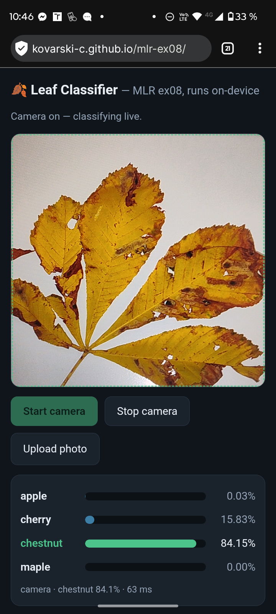
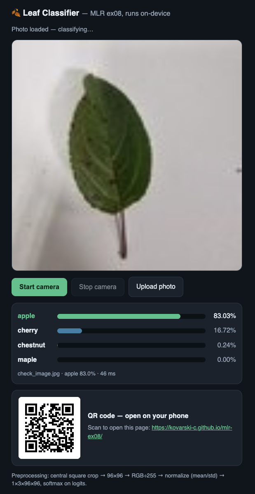

# 1. It runs on your phone
## The Pages URL opens on your phone and classifies the live camera.
Yes

## A screenshot from your phone with a leaf (or a photo of a leaf on another screen) and the probabilities.


# 2. The same numbers as the notebook
## Upload check_image.jpg on the page and write its probabilities next to check_expected.json. 
Probabilities from notebook: 
```python
{
 "apple": 0.8295883536338806,
 "cherry": 0.16795219480991364,
 "chestnut": 0.0024558203294873238,
 "maple": 3.6959847875550622e-06
}
```
Probabilities from the Classifier:


## Do they agree to three decimals?
The numbers do not agree to three decimals but on two decimals they do.

# 3. The preprocessing matches your model

## Find in index.html where the frame is cropped, resized to 96 × 96, divided by 255 and standardized with the mean and std, and in which order the channels go into the tensor. 

- cropped: `var s = Math.min(sw, sh); var sx = (sw - s) / 2, sy = (sh - s) / 2;` (using `workCtx.drawImage` with source offsets `sx, sy` and size `s`)
- resized: `workCtx.drawImage(src, sx, sy, s, s, 0, 0, N, N);` (where `N` is 96)
- divided: `px[o] / 255`
- standardized: `(px[o] / 255 - mean[0]) / std[0]`
- the channels go into the tensor in the order: **RGB** (Red, Green, Blue, arranged sequentially in CHW format across `data`, `data + area`, and `data + 2 * area`)


## Does it match model_info.json and the transform of the notebook?
Transform of the notebook: 
```python
mean = [0.485, 0.456, 0.406]
std = [0.229, 0.224, 0.225]
transform = transforms.Compose([transforms.ToTensor(), transforms.Normalize(mean, std)])

...

x = transform(Image.open("check_image.jpg").convert("RGB")).unsqueeze(0)
```
`model_info.json`: 
```python
{
    "classes": ["apple", "cherry", "chestnut", "maple"], 
    "input_size": 96, "mean": [0.485, 0.456, 0.406],
    "std": [0.229, 0.224, 0.225]
}
```

Yes, it matches. 

* `transforms.ToTensor()` is implemented by scaling raw canvas pixels (`px[o] / 255`) and arranging them into CHW format.
* `transforms.Normalize(mean, std)` is implemented channel-by-channel using the exact mean and std values specified in `model_info.json` (`[0.485, 0.456, 0.406]` and `[0.229, 0.224, 0.225]`).
* The target input size ($96 \times 96$ central crop) strictly follows `model_info.json`.


# 4. Nothing leaves the phone
## Is the image sent anywhere? 
No, the image is not sent anywhere. Code doesn't dontain `fetch`, `axios` or `POST` commands, it doesn't contain any unexpected URL. The app works in airplane mode.  

## Which URLs does the page load, and why?
- [https://cdn.jsdelivr.net/npm/onnxruntime-web@1.21.0/dist/ort.min.js](https://cdn.jsdelivr.net/npm/onnxruntime-web@1.21.0/dist/ort.min.js), [https://github.com/kazuhikoarase/qrcode-generator](https://github.com/kazuhikoarase/qrcode-generator) for QR code generating.
- [https://kovarski-c.github.io/mlr-ex08/](https://kovarski-c.github.io/mlr-ex08/) – my GitHub repo
